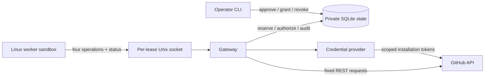

# Implementation design

The worker is untrusted. The gateway, its operator CLI, its private SQLite directory, the credential provider, the kernel, bubblewrap, and the mounted system tools are trusted. One gateway process owns one approved lease. Administrative commands never cross the worker socket.



## Policy

`version: mvp-1` is intentionally distinct from the proposed v0.2 format. All fields and all four capability entries are mandatory. Unknown fields, duplicate JSON keys, booleans in numeric fields, negative counts, non-finite numbers, malformed repo names, and invalid paths are rejected. A zero capability denies that operation. No inheritance or wildcard resources.

The full example is [examples/lease.json](../examples/lease.json). `purpose` grants nothing. `repo` fixes the only GitHub repository. `base_sha` fixes file reads and commit ancestry; `base` fixes the PR target branch name. An operator must check their relationship. The branch can move after approval. Lifetime is 1–86400 seconds, measured from approval by the trusted host clock. Clock rollback is outside the threat model.

| Counter | Exact meaning |
| --- | --- |
| `capabilities.<operation>` | Number of admitted attempts of that operation |
| `limits.operations` | Number of admitted attempts across the four operations |
| `limits.write_operations` | Number of admitted `publish`, `open_pr`, and `comment` attempts |
| `limits.payload_bytes` | Sum of canonical ASCII JSON bytes of each admitted request's `params` |

Payload bytes are **not wire bytes or total network egress**. They do not include transport headers, broker traffic, repeated data in a multi-step publish, responses, or generated stamps. Canonical encoding uses sorted keys, compact separators, and ASCII escaping; a non-ASCII character may occupy several bytes. There is no `cost_usd`, network byte, CPU, or raw HTTP request cap in this version.

One publish costs one logical write operation and makes one GET plus three POSTs: get parent commit, create tree, create commit, create reference. The tree API may create multiple blobs. A cap of one publish is not a cap of one upstream side effect. Every dispatch is logged separately. This explicit definition avoids the source spec's ambiguity around pushes and aggregate writes.

Denied requests and `status` do not consume these counters. Invalid/denied requests are logged; status is observational. Gateway availability and log-volume exhaustion are separate concerns, not solved by the lease's operation budget.

## Worker protocol

One JSON object followed by a newline per Unix stream connection, at most 1 MiB. One response followed by a newline. There are at most eight connection handlers and one operation executes at a time. Each connection has a read timeout. The gateway does not accept unbounded HTTP bodies, proxy headers, alternate credentials, or native Git traffic.

```json
{"operation":"status"}
```

```json
{"id":"read-1","operation":"read_file","params":{"path":"README.md"}}
```

```json
{"id":"change-1","operation":"publish","params":{"message":"Fix flaky test","files":{"test.txt":"new contents\n"}}}
```

```json
{"id":"pr-1","operation":"open_pr","params":{"branch":"lease/RETURNED_LEASE_ID/change-1","title":"Fix flaky test","body":"What changed and how it was checked."}}
```

```json
{"id":"comment-1","operation":"comment","params":{"number":7,"body":"Validation complete."}}
```

The caller cannot select a repo, base, draft state, method, URL, permissions, ref to overwrite, author identity, or token. `open_pr` checks the branch against this lease's persisted successful publishes; `comment` checks the PR against persisted successful PR creation. Ownership is not inferred from a name prefix, bot identity, or forgeable body stamp. Other trusted actors can still alter a branch remotely; this prototype does not freeze remote branch contents after creation.

Reads return text files of at most 256 KiB. Publishing accepts 1–50 UTF-8 text files, each at most 256 KiB and subject to the total request limit. Paths use a deliberately narrow ASCII alphabet. There are no deletions, executable bits, binary blobs, symlinks, or submodules. `.github` writes are denied as defense in depth, not as proof of CI safety.

A worker CLI call is equivalent to the JSON form:

```sh
lease call comment --id comment-1 --params '{"number":7,"body":"Validation complete."}'
```

Responses have `ok: true` and `result`, or `ok: false` and `error`. Denials include a random audit ID, stable code, a plain rule, and `retryable: false`. Limit denials also include `used`, `left`, and `needed`. Error codes include `invalid`, `unknown_operation`, `scope`, `limit`, `conflict`, `in_progress`, `expired`, `revoked`, `uncertain`, and `unavailable`. No code licenses automatic retries with a new ID. A person may grant budget, inspect GitHub, or approve a corrected new lease as appropriate.

## Operation lifecycle

1. Validate the complete request before touching credentials.
2. In `BEGIN IMMEDIATE`, check lifetime/revocation and any previous use of this ID. A changed request under the same ID is a conflict. A completed request returns its persisted result.
3. Check branch/PR ownership, then reserve the operation, aggregate, and payload budgets together. Persist the request digest and a `pending` record with the reservation event in the same transaction.
4. Before **each** GitHub request, commit a dispatch authorization and log record after checking revocation and expiry again. This transaction defines the revocation cutoff. Network I/O runs outside the transaction so an operator can revoke during a slow request.
5. Save the result and successful branch/PR ownership atomically. Upstream exceptions become `uncertain`; no upstream body is echoed to the worker. A provider error may also be an ordinary rejection, but this MVP deliberately handles both conservatively.

On startup, the gateway takes an exclusive process lock, verifies the local audit chain, and converts unfinished reservations to `uncertain`. It never replays them. A crash before sending can therefore consume a budget unit without an effect; a crash after sending can leave an effect without locally recorded ownership. There is no automatic refund, ownership recovery, or reconciliation tool yet. Inspect the provider before doing replacement work.

No remote exactly-once guarantee is claimed. Duplicate delivery under the same ID causes no new upstream calls, provided the authority DB has not been rolled back. Restoring a stale DB backup or deleting it can break that property and is outside the worker threat model. Revoked and expired leases deny cached-operation requests too; status remains available.

## Operator authority

Approval renders the validated policy and its hash. The private directory is created new, mode `0700`; the DB and socket use `0600`. The agent only receives a bind mount of the socket file, never its parent directory. Socket access is the lease capability; it must not be shared with another worker that should have a different budget.

`grant` changes one numeric ceiling. It shows the exact diff, validates the current lease, and compares the policy hash again inside the commit transaction. If policy changed during review, it refuses. It can enable a previously zero capability because the operator is the authority. It cannot change resources or expiration. No socket operation can approve, grant, revoke, or directly write audit records.

`revoke` commits a persistent flag. Every later dispatch authorization fails. An authorized request may still begin or complete its network work after revocation; GitHub may queue downstream activity. The prototype does not kill the worker or erase files it already read. A gateway restart creates a new socket inode; restart sandboxed workers after restarting the gateway.

## Credentials and audit

In App mode, the broker caches one-repository tokens by the operation's needed permissions: Contents read, Contents write, or Pull requests write. It renews when less than a minute remains. The App key never enters the sandbox. App installation permissions and selected repositories are an outer limit; the gateway's closed operation schema supplies the finer limit.

Token-file mode is explicitly operator-scoped and has no auto-refresh. Neither mode uses ambient shell credentials. HTTPS always connects to `api.github.com`, verifies TLS through Python's default HTTPS context, does not read proxy environment variables, does not follow redirects, bounds responses, and never retries. App-token issuance is control-plane traffic, outside worker counters; operation dispatch attempts are audited before token acquisition/network use.

Audit records include approval policy, grants, revocation, request digests, reservations and counters, dispatch method/path, denial codes, and completion digests. Payload bodies are omitted from events; request results, including read file contents, are persisted privately for replay. Protect the entire state directory as sensitive data. The hash chain detects record changes relative to its current stored history; it is neither off-host append-only storage nor protection against a trusted host rewriting/truncating history.
