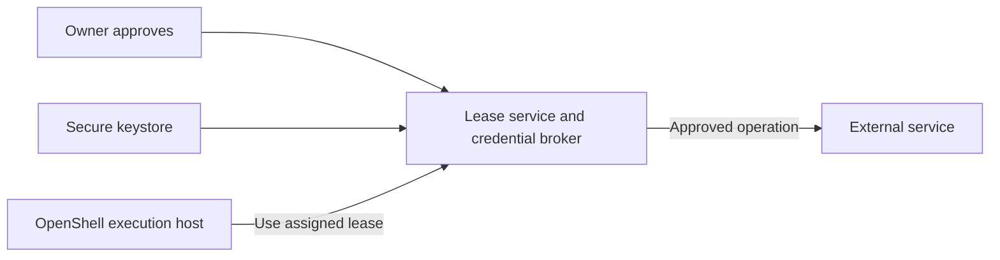

# Portable leases

**Approve a task once. Move the work without copying your credentials or resetting its budget.**

Design proposal · October 28, 2026. This describes a possible next version; the current implementation does not transfer leases or integrate with OpenShell.

## What a lease is

A lease is a record of permission to do a bounded amount of work before a deadline.

It has four parts:

| Part | Example |
| --- | --- |
| Scope | Create draft PRs in one repository, targeting `main` |
| Budget | At most five attempts |
| Deadline | Until 18:00 UTC |
| Assignment | Gateway A, sandbox 17, assignment number 1 |

The lease authority stores the approved terms, usage, and current assignment. The owner can approve changes or revoke the lease. A gateway can use its assigned authority and give it back. It cannot enlarge it.

Suppose the laptop spends two of five PR attempts, then moves the task to a server. The server receives the same lease with three attempts left and the same deadline. The laptop loses permission to start new operations. Previously accepted operations may still finish.

Moving permission does not move a process, files, or a model conversation. Those are separate transfers. The lease's ID, accounting, operation history, and any resource ownership needed to enforce its rules survive the move.

This first protocol keeps the same authority when execution moves. Moving the authority itself requires transferring its current ledger and retiring the old writer; copying an active database to another issuer is not a safe handoff.

## Two pieces to build

**Lease service.** Stores approval, the remaining budget, and the current assignment. It owns the decision to spend authority. It can run on the client machine or beside a secure credential store.

**Execution gateway.** Runs next to the agent's sandbox. It identifies the sandbox and asks to use its lease. OpenShell can supply most of this execution environment.

A keystore keeps secrets; a small service beside it must implement approval, counters, and handoff. Putting a lease document in a vault does not provide those behaviors by itself.

For the strongest gateway restriction, combine the lease service with a credential broker:



The execution host receives a reference to authority it can exercise. The broker keeps service credentials and performs the permitted calls. A compromised host can spend the lease's remaining allowance, but cannot use a broader service key or change the allowance.

## The transferable reference

The first protocol can use ordinary JSON over an authenticated connection. No JWT or custom signed token format is needed for the lease.

A public reference might be:

```json
{
  "version": 1,
  "authority": "https://leases.example",
  "lease_id": "L7"
}
```

This identifies a record; possession does not grant access. The client pins or otherwise trusts the authority's identity before using its address. A gateway authenticates separately, for example with a provisioned mTLS identity. The authenticated identity must match the current assignment.

The authority returns the policy and status to authorized callers. The policy needs service operation names with defined semantics, resource identities, conditions, units, and an absolute deadline. A destination must support that operation profile and its version. An unsupported rule blocks attachment; it must never be silently dropped or translated into a broader rule.

Host paths, process IDs, credential values, and OpenShell configuration belong in runtime bindings, outside the portable terms. Resource identity must survive host changes: for example, a provider account and stable repository ID, displayed alongside its readable name. Merely sharing the same field names does not make two gateways enforce the same policy.

## A small online protocol

Start with five operations, plus status and the existing question/extension channel:

| Operation | Caller | Meaning |
| --- | --- | --- |
| `create(terms)` | Owner | Approve and persist a new lease |
| `attach(lease, destination)` | Owner | Assign an unassigned lease to a prepared gateway and sandbox |
| `use(lease, assignment, operation_id, operation)` | Assigned gateway | Validate, reserve budget, and perform an operation |
| `move(lease, expected_assignment, destination, move_id)` | Owner | Replace the current assignment without changing terms or balance |
| `revoke(lease)` | Owner | Reject future uses |

An agent may propose a move or extension, but cannot approve one. A later version could let the owner preapprove a set of destinations. That would be explicit authority to move, not authority to widen the lease.

### First attachment

1. The owner approves the terms through the lease service.
2. The destination prepares its sandbox and reports the operation profiles it supports. Preparation grants no ability to spend.
3. The lease service verifies the destination identity and compatibility, then binds the lease to that gateway and sandbox.
4. The gateway can now submit operations under that assignment.

The owner still has to trust a platform's enforcement claims. Capability negotiation establishes compatibility; it does not prove that a hostile host is running the advertised software.

### Using the lease

A use request includes a stable operation ID and the intended operation. The authority checks the authenticated gateway, sandbox binding, current assignment number, scope, deadline, and all relevant budgets in one transaction. It derives charges from the actual operation; the gateway cannot declare its own cost or resource scope.

In brokered mode, the authority reserves before dispatch and records the result. Retrying the same operation ID and contents returns the recorded result or an in-progress/uncertain state. It never turns a recorded approval into another dispatch. The operation ID is unique within the lease across all hosts; changing assignment does not create a new operation.

Failed or uncertain attempts stay charged. General APIs do not guarantee exactly-once effects, so the protocol must preserve uncertainty instead of treating a missing response as proof that nothing happened.

### Moving between hosts

Prepare B, then submit:

```json
{
  "lease_id": "L7",
  "expected_assignment": 1,
  "destination": {"gateway": "B", "sandbox": "92"},
  "move_id": "move-8"
}
```

The authority atomically replaces A's binding with B's and increments the assignment number to 2. This is a conditional update: a competing move with the old number fails. Retrying `move-8` returns its recorded outcome.

After that transaction, A's old assignment cannot authorize new operations, even if A is disconnected, ignores a stop message, or resumes an old machine snapshot. B sees the existing usage, including outstanding reservations. There is no budget export to reconcile and no requirement to believe A has deleted a file.

An operation authorized before the move can still finish afterward. Its reservation stays in the same ledger. For workflows that require all old effects to finish before new work starts, add a drain step; it can block when the external outcome is unknown.

If B fails after activation, the owner can move the lease again. A lost reply is resolved by reading authority state or retrying the same move ID, not by reactivating both hosts.

## What “limited authority” promises

There are two useful deployment choices:

| Choice | Where the service key lives | What must be trusted |
| --- | --- | --- |
| Broker performs each operation | Beside the lease authority | Broker for scope and accounting; execution host can spend only its lease |
| Gateway receives a scoped credential | In the trusted gateway/supervisor | Gateway for every restriction finer than the provider's own credential scope |

The first is the stronger default when hosts should have limited authority. The second fits an operator-controlled OpenShell installation and may be cheaper or faster.

Encrypting a broad key for a gateway protects delivery. Once decrypted, that key still has its original power. Neither an expiry field nor a signed lease forces a malicious gateway to honor “five PRs” if the provider key permits unlimited PR creation. OpenShell middleware can enforce such a cap only while OpenShell and the gateway remain trusted.

A broker that holds only its own credentials also cannot prevent an independently compromised host from using other credentials it already has. Its guarantee covers the authority delegated through this lease.

## What if the client goes offline?

The online design stops new operations when the authority is unavailable. If the authority runs on a laptop, the laptop must remain reachable. A persistent service beside the keystore is a better issuer for unattended work.

Offline execution is a different mode. The authority could reserve a fixed portion of the budget for a named gateway until a deadline. Those units remain unavailable elsewhere until settlement; a timeout alone does not prove they were unused. Revocation is delayed, and preventing cloned local state from spending twice requires trusted enforcement, protected accounting state, or provider-native limits.

I would defer this. An offline, freely copyable lease file cannot provide both a hard shared spend cap and immediate revocation. A signed document authenticates a grant; it does not stop double spending.

## Rebuilding on OpenShell

I recommend using OpenShell as the runtime and keeping the lease protocol independent of it. The current prototype is useful as a reference for ledger behavior, but maintaining another sandbox launcher, network boundary, and credential plumbing distracts from portable authority.

I checked [OpenShell v0.1.6](https://github.com/NVIDIA/OpenShell/releases/tag/v0.1.6), released October 27, against its tagged source (`ac7f615cd12d5cc49cb16eb1f5f10ffeb1e90f47`). The integration below is a design assessment, not a tested integration.

| Reuse from OpenShell | Lease-specific work that remains |
| --- | --- |
| Sandbox lifecycle, process/filesystem controls, network mediation | Portable terms, expiry, and current assignment |
| Provider configuration and secret-store integration | Deciding whether to delegate a credential or retain it at the broker |
| Per-request middleware and control-plane interceptors | Atomic budgets, handoff, operation history, approval and extension semantics |
| Existing client and runtime integrations | Service-specific interpretation of counted operations |

OpenShell separates the workload from a trusted supervisor and provides an outer network fence. That is a better place to reuse process and network isolation. [Architecture source](https://github.com/NVIDIA/OpenShell/blob/v0.1.6/docs/about/architecture.mdx).

For a **trusted-gateway implementation**, supervisor middleware is the useful hook: it receives inspected HTTP requests before credentials are injected. It can contact the lease service to reserve an attempt and deny exhausted, expired, or stale assignments. Gateway interceptors can install the lease policy and refuse policy/provider changes that exceed it. Bind authenticated gateway and sandbox IDs to the assignment; do not trust worker-supplied lease headers. [Middleware](https://github.com/NVIDIA/OpenShell/blob/v0.1.6/docs/extensibility/supervisor-middleware/index.mdx), [request context](https://github.com/NVIDIA/OpenShell/blob/v0.1.6/proto/supervisor_middleware.proto), [interceptors](https://github.com/NVIDIA/OpenShell/blob/v0.1.6/docs/extensibility/gateway-interceptors.mdx).

Configure the request binding explicitly and fail closed. A cached `allow` is not permission to forward the request again: middleware retry IDs, downstream retry behavior, and accounting need a tested contract. Generic middleware is not an exactly-once execution broker. [Binding configuration](https://github.com/NVIDIA/OpenShell/blob/v0.1.6/docs/extensibility/supervisor-middleware/configure.mdx).

For a **brokered implementation**, start by allowing the sandbox only to reach the lease service for leased effects. Reuse the current named operations behind that service. OpenShell owns isolation; the lease service owns scope, spending, and dispatch. Transparent native-client traffic through a remote broker would need a separate routing integration; a middleware `allow` decision does not provide it.

There are three integration limits to keep explicit:

- OpenShell's credential driver resolves handles into secret values. It is a storage interface, not a mechanism for enforcing a per-operation budget on a host that receives the secret. [Credential driver contract](https://github.com/NVIDIA/OpenShell/blob/v0.1.6/proto/credential_driver.proto).
- Middleware does not cover every protocol. In this release, WebSocket binary messages bypass its message inspection, `tls: skip` cannot be inspected, and response inspection has additional restrictions. Exclude unsupported paths when they could spend lease authority. Local stdio MCP calls are not HTTP traffic; counting tool calls themselves still needs an MCP-aware boundary. [Coverage limits](https://github.com/NVIDIA/OpenShell/blob/v0.1.6/docs/extensibility/supervisor-middleware/operations.mdx).
- OpenShell uses JWTs internally for sandbox and extension authentication. The portable lease format need not use them, but an absolute “no JWT anywhere” requirement would require changes to OpenShell. Its extension transport also does not currently provide mTLS client authentication; a proposed mTLS lease API is a separate interface, not an existing middleware option. [Authentication](https://github.com/NVIDIA/OpenShell/blob/v0.1.6/docs/extensibility/overview.mdx).

## The next experiment

Build one online lease service and an OpenShell runtime adapter. Start in brokered mode so the execution hosts receive no service keys. Keep one operation profile and one active assignment per lease. Use existing authenticated transports and a durable ledger; leave offline grants, arbitrary protocol translation, and host attestation for later.

The demonstration should be small:

1. Approve five operations once.
2. Use two from an OpenShell sandbox on A.
3. Prepare a sandbox on B and move the lease.
4. Verify B can use three more, A cannot start another, and the deadline is unchanged.
5. Repeat with A unreachable, a lost move reply, an operation in flight, a restored old snapshot, and concurrent move requests.
6. Revoke; verify new uses fail. Disconnect the authority; verify the runner fails closed.

That proves the distinctive feature: permission and its remaining budget follow the task across hosts. OpenShell supplies the execution environment around it.
